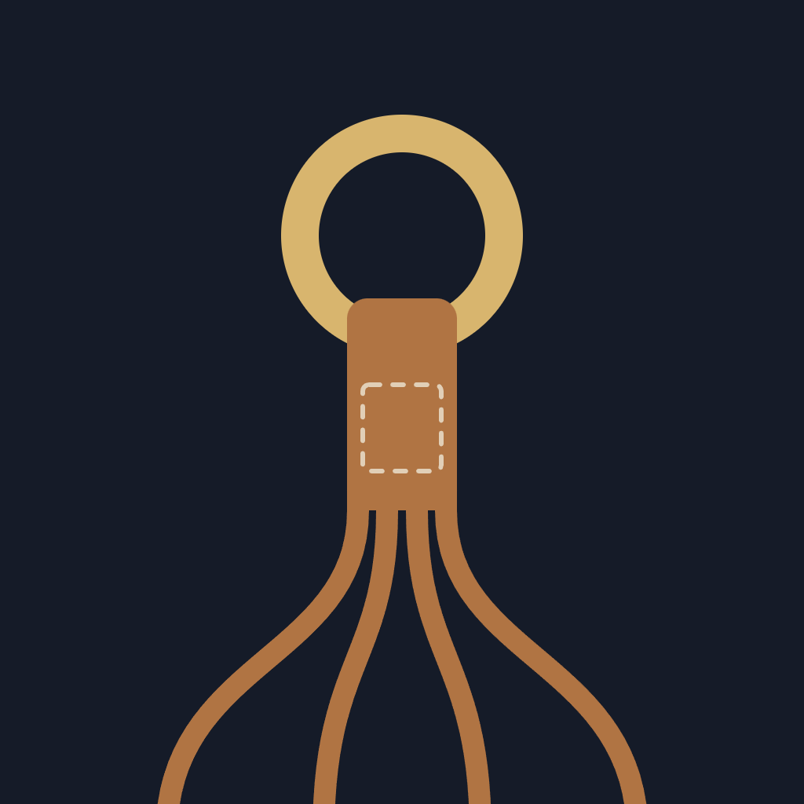

<p align="center">
  
</p>

# Reins

A mobile chat client for Codex and Claude agents on your own servers, using
[Herdr](https://github.com/herdrdev/herdr) and SSH.

- **Chats:** conversations across servers, provider/model/effort selection,
  project shortcuts, voice dictation, saved drafts, notifications and approvals.
- **Servers:** SSH connections, pairing, keys and jump hosts. Open a terminal
  from any server when you need a shell.
- **Settings:** notifications, security, theme/language and basic terminal options.

Chat messages support web links, attachments and remote file previews, including
images at original resolution. Agents keep running when you leave the app.
Codex connects to the official shared daemon using exact thread IDs; Claude uses
Herdr’s existing transcript integration. New Claude chats default to auto mode;
new Codex chats use automatic approval review.

See [installation, daily use and building an APK](docs/chat-mode.md). Android
updates retain the existing Reins/Whip Chat package ID and signing identity so
saved servers and SSH keys survive installation over a previous personal build.

## Development

```sh
npm ci
npx tsc --noEmit
npm run lint
npm test -- --runInBand
bash scripts/build-chat-apk.sh
```

The build requires the Android SDK/NDK, Java, Rust and your private signing
configuration; see the installation guide. The signed APK is written to
`artifacts/reins-arm64.apk`.

## License and credits

Reins is an independent fork of [Whip](https://github.com/kosumic/whip) by kosumic
and contributors, modified in October 2026. Licensed under
[AGPL-3.0-or-later](LICENSE). Original copyright and third-party notices are
retained and available in Settings → About → Open-source licenses.
Reins is not an official Herdr, Codex or Claude app.
